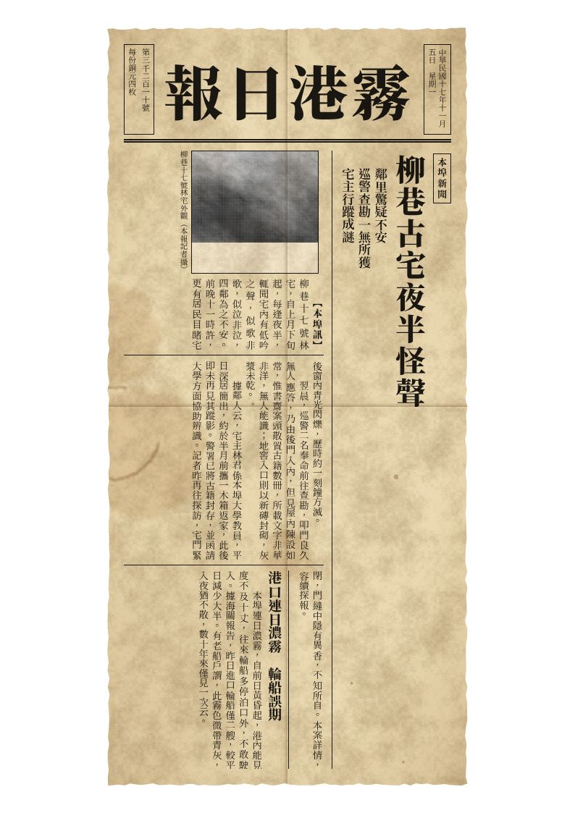

# 民國道具舖

繁體中文、直排、民國風（1920～30 年代）的跑團道具產生器，適合 1920～30 年代背景的克蘇魯神話調查跑團。
守秘人在瀏覽器裡填內容、即時預覽，再用瀏覽器的列印功能存成 PDF 或直接印出來，
印在 A4、A5 或名片紙上，發給玩家當線索。

純前端靜態網頁：沒有後端、不需要帳號、不收集任何資料。

| 報紙剪報 | 電報 | 信箋 | 名片／請帖 |
| --- | --- | --- | --- |
|  |  |  |   |

## 道具種類

1. **報紙剪報**：直排內文、由上而下分段並加欄線；虛構報頭（或內頁的報眉）、民國紀年與星期、號數與售價；
   標題、副題、電頭與內文，可加一則短訊與一張照片（照片轉成灰階網點質感，文字繞排）。
   可選「貼合內容」，讓剪報像真的從報上剪下來的一則新聞，並加上剪刀剪過的毛邊。
2. **電報**：電報局的收報紙或發報紙格式。正文逐字放進方格，每個字旁邊標上四碼中文電碼；
   查不到電碼的字會以紅框標示，並在介面列出。落款可用「韻目代日」（例如二十一日＝「馬」），
   也可加上地支代月（五月＝「辰」）。方格內容可選「只有電碼」，讓玩家自己查電碼本譯電。
3. **信箋**：紅格直排信紙（八行箋，或十、十二、十四行），稱謂、正文、結尾敬語（第二行另起頂格）、署名、民國紀年日期；
   手寫風格字型，墨色可選。
4. **名片／請帖**：名片尺寸 90×54 mm（直式或橫式），名片含機關職銜、姓名、字號、籍貫、住址與電話；
   請帖為大紅底金字的直排格式。可單張列印，或在一張 A4 上拼版 10 張並附裁切線。

共通功能：

- 左邊表單、右邊即時預覽；超出版面時會提醒。
- 紙張做舊：泛黃、紙紋、摺痕、水漬與杯底圓環、印泥質感，全部以 CSS 與 SVG／canvas 即時產生，沒有使用任何圖片素材。
- 民國紀年自動換算（1912 年＝民國元年）、中文數字（含「廿」「卅」寫法）、星期。
- 內容自動存在瀏覽器的 localStorage；無痕模式等無法儲存的情況下照常運作，只是關閉後不保留。
- 可匯出／匯入 JSON 存檔（照片也包含在檔案裡），方便備份或在不同電腦間搬移。

預設的報頭、電報局、店號、人名與地名（「霧港」等）全部是虛構的。報頭請勿改用真實報紙的名稱。

## 怎麼用

把建置好的 `dist/` 放到任何靜態網站伺服器（GitHub Pages、Netlify、自己的主機都可以），用瀏覽器開啟即可。
也可以在本機執行（見下方「本機開發」）。

> 因為使用 ES 模組並以 `fetch` 讀取電碼表，請透過網址（`http://` 或 `https://`）開啟，
> 直接雙擊 `dist/index.html`（`file://`）大多數瀏覽器會擋下。

1. 在上方分頁選擇道具種類。
2. 在左邊表單填寫內容，右邊會即時更新預覽。
3. 按「列印／存成 PDF」。

## 怎麼列印

- 按「列印／存成 PDF」後，在瀏覽器的列印對話框：
  - 目的地選「儲存為 PDF」或你的印表機；
  - **邊界選「無」**、**縮放 100%**（不要選「縮至紙張大小」）；
  - **勾選「背景圖形」**（否則紙張底色、做舊效果、紅格線不會印出）。
- 紙張大小由頁面自動設定（A4、A5、名片 90×54 mm），列印時只會印出道具本身。
- 名片若用一般印表機印，建議選「A4 拼版 10 張」，印好後沿虛線裁切。
- 以 Chromium 系瀏覽器（Chrome、Edge）測試最完整；Firefox 與 Safari 對自訂紙張大小的支援程度不同，
  若紙張大小不對，請在列印對話框手動選擇對應的紙張。
- 一般家用印表機無法印到紙張最邊緣，滿版的信箋與電報四周可能留下幾公釐白邊，屬正常現象。

## 隱私

- 不收集任何資料：沒有分析、沒有追蹤、沒有 Cookie、不連線到任何第三方服務。
- 網站自己提供字型，不會連到 Google Fonts 或其他字型服務。頁面的 Content-Security-Policy 只允許載入同一網站的資源。
- 你填寫的內容與照片只存在你自己的瀏覽器（localStorage）與你匯出的 JSON 檔裡，不會上傳。
- 照片用 FileReader 讀進瀏覽器、以 canvas 縮小後重新編碼；這一步也會去掉相機寫入的 EXIF（例如拍攝地點）。
- 「清除本機資料」按鈕會刪除這個網站存在你瀏覽器裡的全部內容。

## 資料與字型的來源和授權

### 中文電碼

- 來源：Unicode Unihan 資料庫 **17.0.0** 的 `Unihan.zip`（<https://www.unicode.org/Public/17.0.0/ucd/Unihan.zip>），
  `Unihan_OtherMappings.txt` 中的 `kTaiwanTelegraph` 欄位（9,024 字）。
- 授權：Unicode License v3，見 [`licenses/Unicode-License-v3.txt`](licenses/Unicode-License-v3.txt)。
- `src/data/telegraph.json` 由 [`scripts/unihan-telegraph.ts`](scripts/unihan-telegraph.ts) 產生：
  下載固定版本的 `Unihan.zip`、驗證寫在腳本裡的 SHA-256
  （`f7a48b2b545acfaa77b2d607ae28747404ce02baefee16396c5d2d7a8ef34b5e`）、
  以 Node 內建的 `node:zlib` 解壓，再取出需要的欄位。
- **異體字代查**：電碼本收的常是舊字形（例如「啓」「卽」「爲」），現代常用的「啟」「即」「為」反而查不到。
  腳本依 `Unihan_Variants.txt` 的 `kZVariant`、`kSemanticVariant`、`kSpoofingVariant`，
  以及只對應一個繁體字的 `kTraditionalVariant`，為 3,645 個沒有電碼的字找出可代查的異體字；
  介面會列出哪些字改用了異體字的電碼。
- `kTaiwanTelegraph` 是臺灣使用的標準電碼，與民國時期的電碼本大致相同，但個別字可能有出入。

### 韻目代日

民國電報以平水韻的韻目字代表日期：1～15 日用上平聲十五韻（東冬江支微魚虞齊佳灰真文元寒刪），
別用下平聲（先蕭肴豪歌麻陽庚青蒸尤侵覃鹽咸）；16 日起取上聲或去聲的第 N 韻
（銑篠巧皓哿馬養漾敬有寢感儉豔；20 日亦作「號」），30 日寫「卅」（亦作「陷」），31 日寫「世」或「引」；
月份以地支代表（子＝一月……亥＝十二月）。對照表在 [`src/lib/yunmu.ts`](src/lib/yunmu.ts)，依據下列資料整理，並以史例交叉檢查：

- 維基百科〈代日韻目〉（<https://zh.wikipedia.org/zh-tw/代日韻目>）及其討論頁；
- 古文維基百科〈韻目代日〉（<https://zh-classical.wikipedia.org/wiki/韻目代日>）；
- 維基文庫〈平水韻〉的韻目次序（<https://zh.wikisource.org/zh-hant/平水韻>）；
- 以韻目命名的史事：馬日事變（1927 年 5 月 21 日）、文夕大火（1938 年 11 月 12 日夜）、豔電（1938 年 12 月 29 日）、
  皓電（1940 年 10 月 19 日）、佳電（1940 年 11 月 9 日）、齊電（1940 年 12 月 8 日）。這些例子都寫進了測試。

### 字型

| 字型 | 風格 | 來源套件（版本） | 授權全文 |
| --- | --- | --- | --- |
| 思源宋體 Noto Serif TC（可變字重） | 印刷明體（預設標題與內文） | `@fontsource-variable/noto-serif-tc` 5.3.1 | [`licenses/OFL-Noto-Serif-TC.txt`](licenses/OFL-Noto-Serif-TC.txt) |
| 仙人掌明體 Cactus Classical Serif | 鉛字風格的傳統明體，最有民國印刷味 | `@fontsource/cactus-classical-serif` 5.3.1 | [`licenses/OFL-Cactus-Classical-Serif.txt`](licenses/OFL-Cactus-Classical-Serif.txt) |
| 霞鶩文楷 TC（LXGW WenKai TC） | 楷書（預設手寫） | `@fontsource/lxgw-wenkai-tc` 5.3.1 | [`licenses/OFL-LXGW-WenKai-TC.txt`](licenses/OFL-LXGW-WenKai-TC.txt) |
| 芫荽 Iansui | 鋼筆手寫 | `@fontsource/iansui` 5.3.1 | [`licenses/OFL-Iansui.txt`](licenses/OFL-Iansui.txt) |
| jf open 粉圓 Huninn | 現代圓體（不太像民國，但可選） | `@fontsource/huninn` 5.3.1 | [`licenses/OFL-Huninn.txt`](licenses/OFL-Huninn.txt) |

字型套件只在建置時讀取，`pnpm build` 會把依 Unicode 範圍切好的 woff2 分片複製到 `dist/fonts/`，
瀏覽器只下載實際用到的分片。授權全文在 [`licenses/`](licenses/)，彙整見 [`THIRD_PARTY_NOTICES.md`](THIRD_PARTY_NOTICES.md)。

## 本機開發

需要 Node.js 24 與 pnpm 11（版本釘選在 `package.json` 的 `packageManager`；
已安裝其他版本的 pnpm 時，pnpm 會自動切換到釘選的版本）。

```bash
pnpm install
```

```bash
pnpm build
```

```bash
pnpm serve
```

開啟 <http://127.0.0.1:4173/>。其他指令：

| 指令 | 說明 |
| --- | --- |
| `pnpm typecheck` | TypeScript 型別檢查（strict） |
| `pnpm test` | 以 Node 內建的 `node --test` 測試純邏輯：電碼查詢、民國紀年、中文數字、韻目代日、存檔格式、ZIP 解壓等 |
| `pnpm build` | 編譯並輸出靜態網站到 `dist/` |
| `pnpm serve` | 只綁定 127.0.0.1 的本機預覽伺服器（提供 `dist/`） |
| `pnpm data:telegraph` | 從 unicode.org 下載 `Unihan.zip` 並重新產生 `src/data/telegraph.json` |
| `pnpm data:check` | 重新產生並與已提交的電碼資料比對（不寫入） |

`pnpm data:telegraph --zip 路徑/Unihan.zip` 可改用本機已下載的 `Unihan.zip`（一樣會驗證 SHA-256）。

### 專案結構

```text
src/
  index.html          頁面（含做舊用的 SVG 濾鏡）
  main.ts             主程式：表單、預覽、自動保存、匯出入
  state.ts            存檔格式（匯出／匯入、localStorage 共用）
  lib/                純邏輯：民國紀年、中文數字、韻目代日、電碼查詢、localStorage 包裝
  props/              四種道具的欄位定義與預設內容
  render/             四種道具的版面與做舊效果
  ui/                 表單產生器、照片處理
  styles/             介面、道具與列印樣式
  data/telegraph.json 電碼資料（由腳本產生）
scripts/              建置、本機伺服器、電碼資料產生腳本
test/                 node --test 測試
licenses/             第三方授權全文
```

### 供應鏈安全

- 執行期零依賴：網站只有自己的程式碼、字型與資料。
- 開發依賴只有 `typescript`、`@types/node` 與兩個字型套件，全部釘選確切版本並提交 `pnpm-lock.yaml`。
- `pnpm-workspace.yaml` 設定 `minimumReleaseAge: 10080`（新版本發布滿 7 天才會被安裝）、
  `trustPolicy: no-downgrade`，並禁止任何依賴執行安裝腳本。
- CI 只有讀取權限、不使用任何機密；每個 GitHub Action 都以完整 commit SHA 釘選。
- Dependabot 每週檢查 npm 與 GitHub Actions，並設定 7 天冷卻期。
- 不使用 Python；建置、資料處理與測試都只用 Node.js 與 TypeScript。

## 授權

程式碼以 [MIT 授權](LICENSE) 釋出，著作權人為奇譚工坊（qitan-works）。
字型與 Unicode 資料各依其授權條款散布，見 [`THIRD_PARTY_NOTICES.md`](THIRD_PARTY_NOTICES.md)。
